# Diagramas de Flujo de Acciones de Usuario — SBN MCP

> **Sistema:** Gestión de Bienes Nacionales — Maternidad Concepción Palacios (UPTEC-MS)
> **Documento:** Flujos de interacción del usuario final por rol y por tarea
> **Base:** Análisis de `app/views` (UI), `app/controllers` (comportamiento) y rutas en `app/core/App.php`

---

## Índice de flujos

| # | Flujo | Usuario objetivo |
|---|-------|------------------|
| U-01 | Navegación principal del sistema (todos los roles) | Todos |
| U-02 | Inicio de sesión y primer acceso | Todos |
| U-03 | Recuperación de contraseña olvidada | Todos |
| U-04 | Registrar un bien nacional (formulario 6 pasos) | administrador, gerencia_bn, registrador |
| U-05 | Buscar, filtrar y ver bienes | Todos |
| U-06 | Editar un bien | administrador, gerencia_bn, controlador_inventario |
| U-07 | Desincorporar un bien | administrador, gerencia_bn |
| U-08 | Verificar semestralmente un bien | administrador, gerencia_bn, validador_inventario |
| U-09 | Crear un acta de movimiento | administrador, gerencia_bn |
| U-10 | Descargar acta (Word/PDF) | Todos los roles |
| U-11 | Generar y exportar reportes BM-1 a BM-4 | administrador, gerencia_bn, controlador_inventario |
| U-12 | Consultar el Control Mural por departamento | Todos |
| U-13 | Gestionar usuarios (administrador) | administrador |
| U-14 | Registrar y gestionar mantenimientos | administrador, gerencia_bn |
| U-15 | Revisar auditoría del sistema | administrador, gerencia_bn, controlador_inventario |
| U-16 | Administrar configuración y backups | administrador |
| U-17 | Cerrar sesión | Todos |

---

## U-01: Navegación principal del sistema

El menú lateral (`app/views/partials/sidebar.php`) cambia según el rol del usuario autenticado.

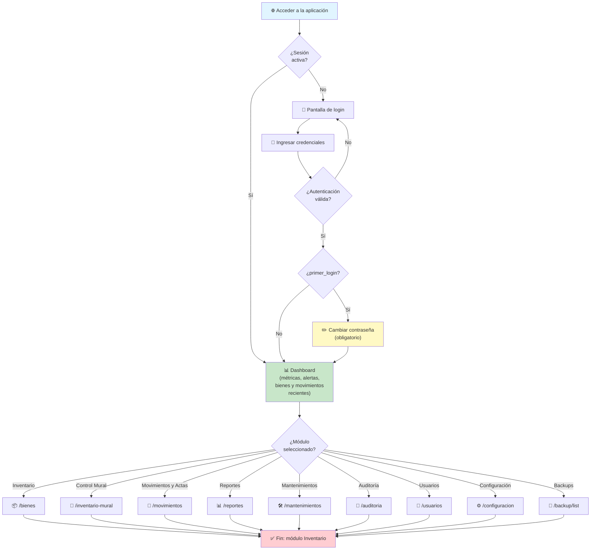

**Visibilidad por rol (según rutas en `App.php`):**

| Módulo | admin | gerencia_bn | controlador_inventario | registrador |
|--------|:-----:|:-----------:|:----------------------:|:-----------:|
| Dashboard | ✅ | ✅ | ✅ | ✅ |
| Inventario /bienes | ✅ | ✅ | ✅ | ✅ |
| Registrar bien | ✅ | ✅ | — | ✅ |
| Editar bien | ✅ | ✅ | ✅ | — |
| Desincorporar bien | ✅ | ✅ | — | — |
| Control Mural | ✅ | ✅ | ✅ | ✅ |
| Movimientos (ver) | ✅ | ✅ | ✅ | ✅ |
| Crear actas | ✅ | ✅ | — | — |
| Reportes | ✅ | ✅ | ✅ | — |
| Mantenimientos (ver) | ✅ | ✅ | ✅ | — |
| Mantenimientos (crear/editar) | ✅ | ✅ | — | — |
| Auditoría | ✅ | ✅ | ✅ | — |
| Usuarios | ✅ | — | — | — |
| Configuración | ✅ | — | — | — |
| Backups | ✅ | — | — | — |

---

## U-02: Inicio de sesión y primer acceso

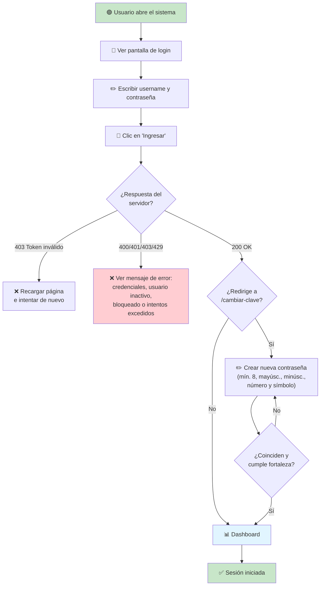

---

## U-03: Recuperación de contraseña olvidada

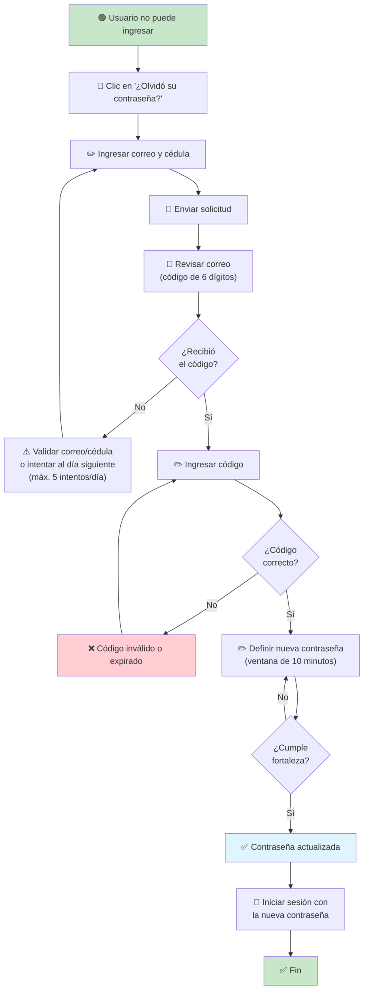

---

## U-04: Registrar un bien nacional (6 pasos)

Formulario multietapa (`app/views/bien/create.php`) con validación AJAX de duplicados.

```mermaid
flowchart TD
    A["🟢 Ir a Inventario →<br/>'Registrar Nuevo Bien'"] --> B["📋 Paso 1 · Clasificación"]
    B --> B1["✏️ Seleccionar tipo de bien<br/>(Publicación 9)"]
    B1 --> B2["✏️ Código ministerio (opc.)<br/>+ Nro. de Bien (según rol)"]
    B2 --> B3["✏️ Seleccionar estado<br/>(Operativo, Inoperativo,<br/>En Resguardo, Chatarra)"]
    B3 --> B4["➡️ Siguiente"]
    B4 --> C["📋 Paso 2 · Identificación"]
    C --> C1["✏️ Nombre (obligatorio),<br/>descripción, marca,<br/>modelo, serial, color"]
    C1 --> C2["✏️ Año fabricación, condición,<br/>cantidad"]
    C2 --> C3["📸 Foto del bien (opcional,<br/>jpg/png/webp máx 5 MB)"]
    C3 --> C4["➡️ Siguiente"]
    C4 --> D["📋 Paso 3 · Ubicación"]
    D --> D1["✏️ Seleccionar área<br/>(edificio/piso/departamento)"]
    D1 --> D2["✏️ Oficina y posición"]
    D2 --> D3["🔄 Sistema genera C.I.N:<br/>Edificio/Piso/Depto/Oficina/Posición"]
    D3 --> D4["➡️ Siguiente"]
    D4 --> E["📋 Paso 4 · Responsable"]
    E --> E1["✏️ Buscar usuario responsable<br/>(o ingresar nombre+cédula)"]
    E1 --> E2["📸 Foto del responsable (opc.)"]
    E2 --> E3["➡️ Siguiente"]
    E3 --> F["📋 Paso 5 · Datos Económicos"]
    F --> F1["✏️ Valor inicial (defecto 0),<br/>valor residual, vida útil<br/>(defecto 10 años)"]
    F1 --> F2["✏️ Nº factura y fecha de<br/>adquisición (opc.)"]
    F2 --> F3["➡️ Siguiente"]
    F3 --> G["📋 Paso 6 · Observaciones"]
    G --> G1["✏️ Notas (opcional)"]
    G1 --> G2["🔘 Guardar Bien"]
    G2 --> H["🔍 Validación AJAX<br/>duplicados (nro, serial,<br/>código ministerio)"]
    H --> H1{"¿Todo<br/>válido?"}
    H1 -->|No| H2["❌ Volver al paso<br/>con el error"]
    H2 --> G1
    H1 -->|Sí| I["🎉 Modal de éxito:<br/>'Bien registrado correctamente'"]
    I --> J["🔄 Redirigir a /bienes"]
    J --> K["✅ Fin: bien visible<br/>con códigos generados"]

    style A fill:#c8e6c9
    style K fill:#c8e6c9
    style I fill:#e1f5ff
    style H2 fill:#ffcdd2
```

---

## U-05: Buscar, filtrar y ver bienes

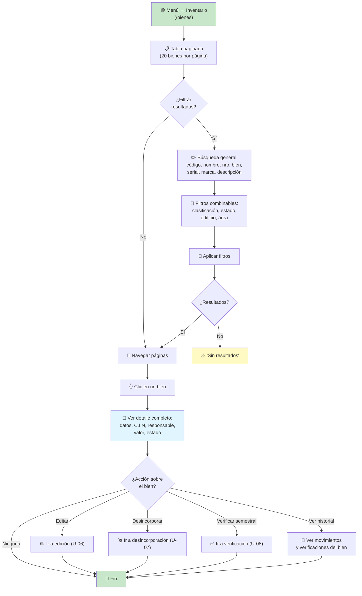

---

## U-06: Editar un bien

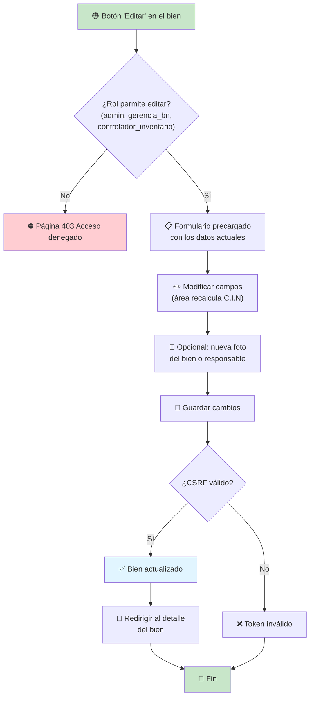

---

## U-07: Desincorporar un bien (dar de baja)

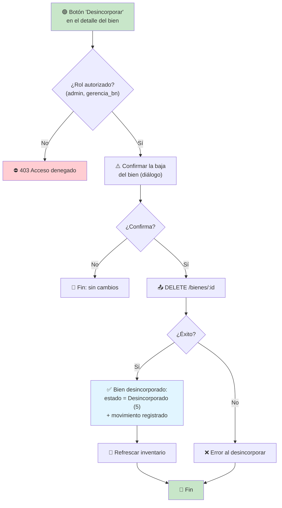

---

## U-08: Verificar semestralmente un bien

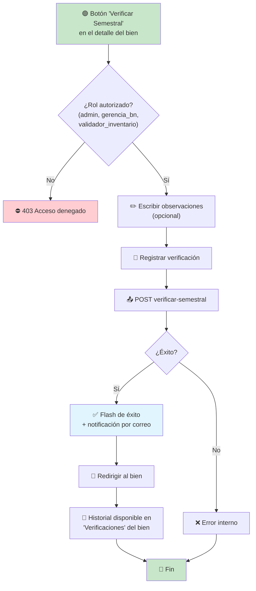

---

## U-09: Crear un acta de movimiento

Solo administrador y gerencia_bn. El acta se genera con formato institucional, se previsualiza y se guarda con su contenido.

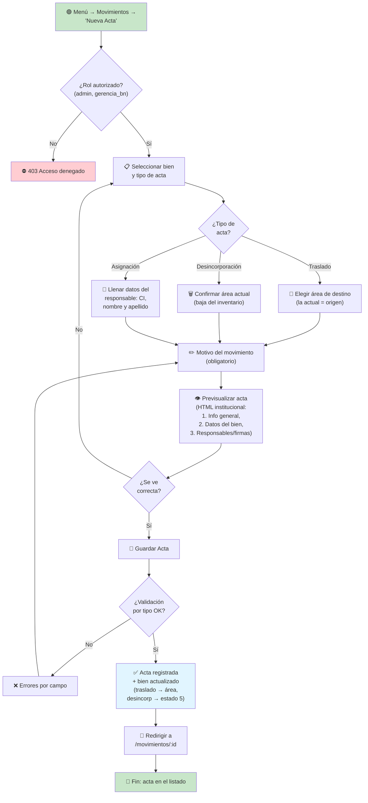

---

## U-10: Descargar acta (Word / PDF)

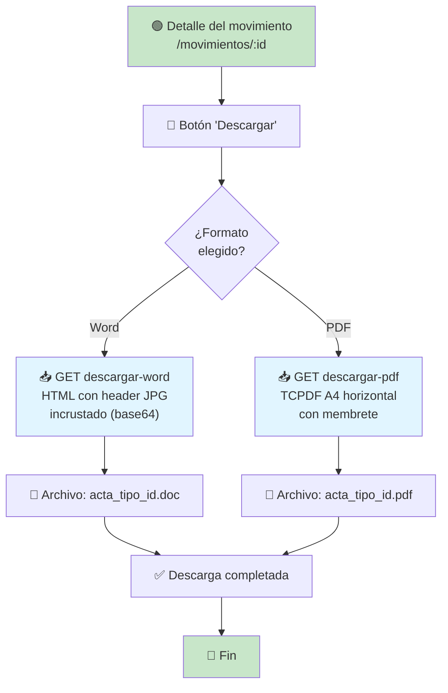

---

## U-11: Generar y exportar reportes (BM-1 a BM-4)

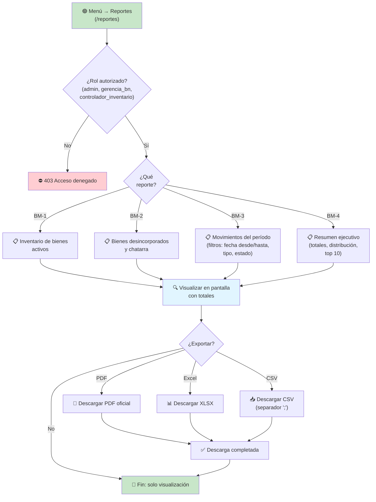

---

## U-12: Consultar el Control Mural por departamento

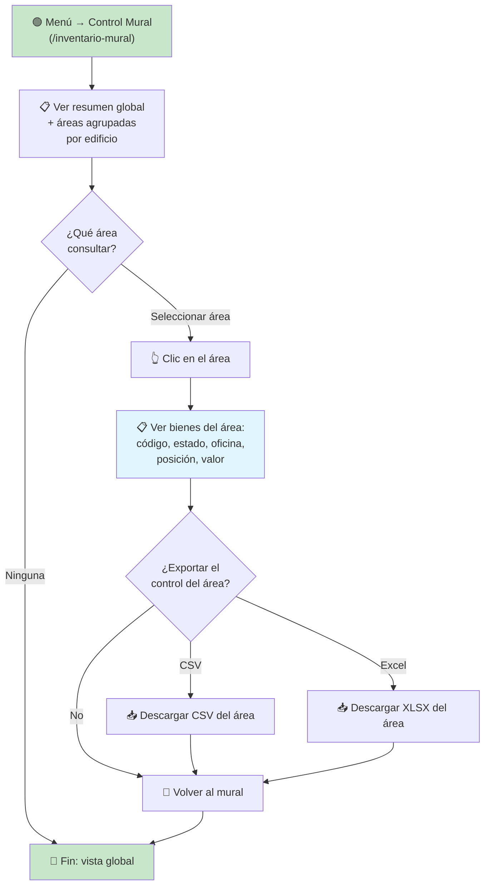

---

## U-13: Gestionar usuarios (administrador)

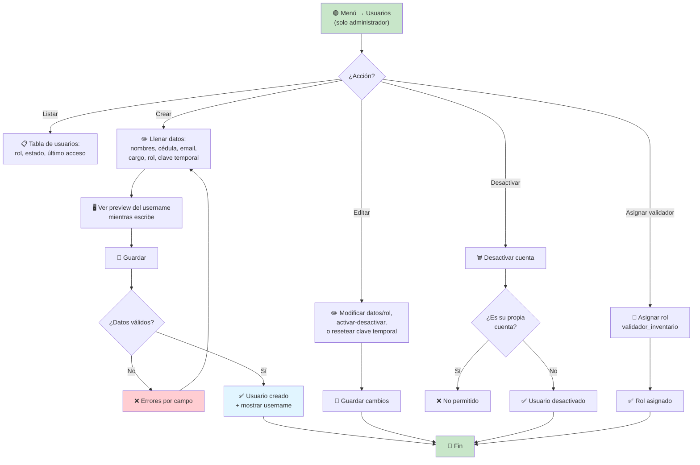

---

## U-14: Registrar y gestionar mantenimientos

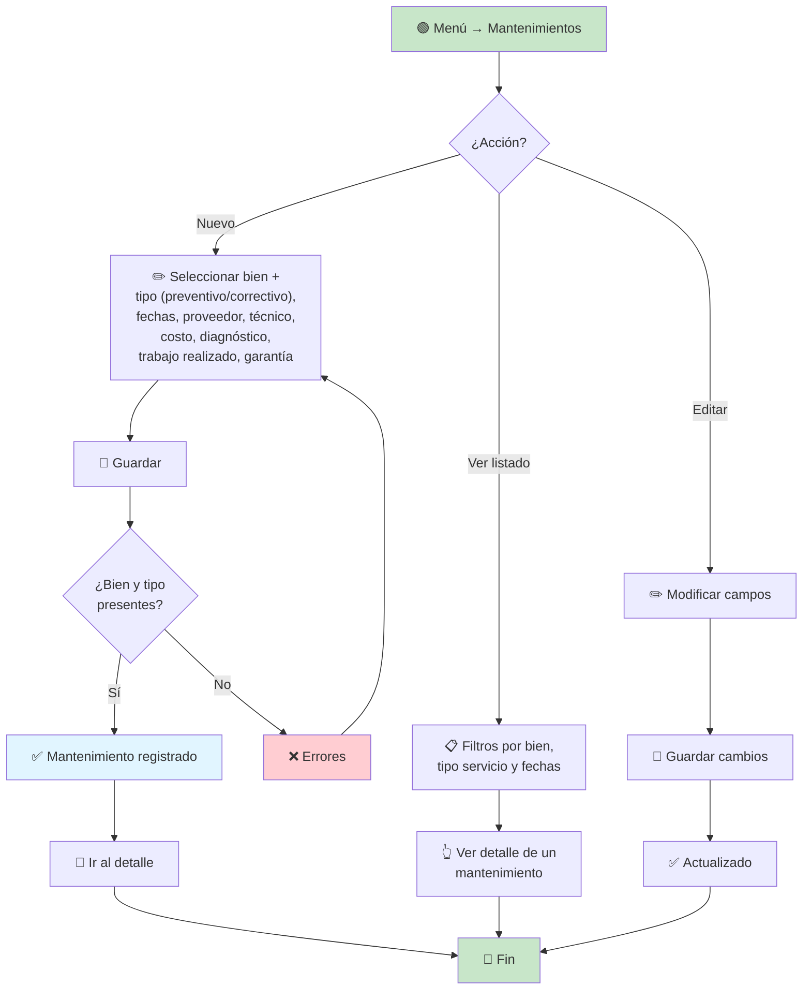

---

## U-15: Revisar auditoría del sistema

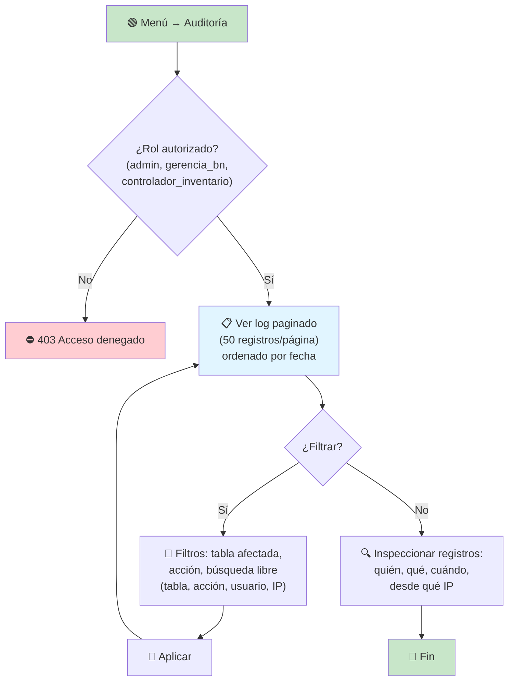

---

## U-16: Administrar configuración y backups (administrador)

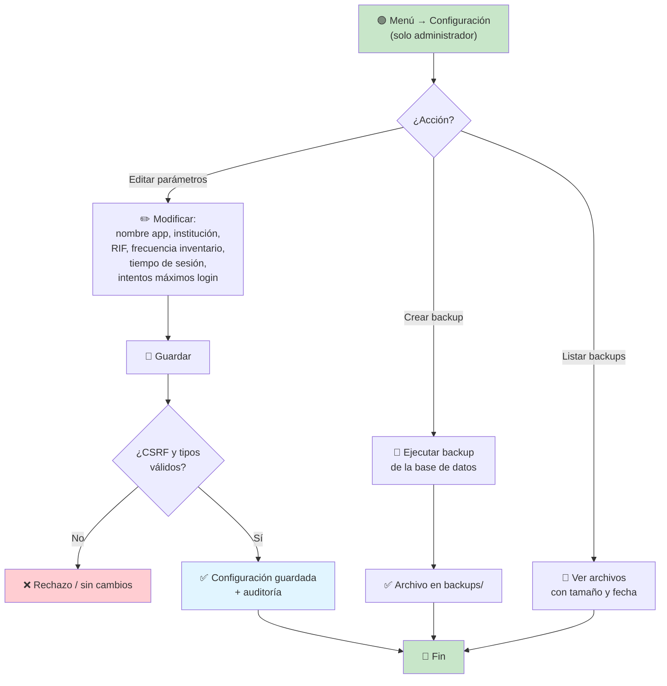

---

## U-17: Cerrar sesión

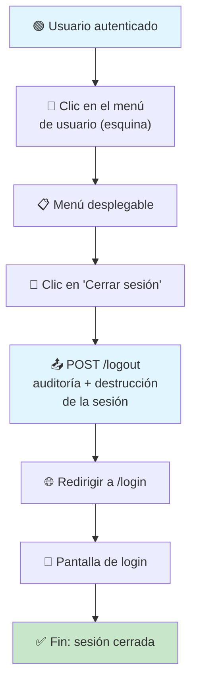

---

## Leyenda de símbolos

- 🟢 **Inicio / Fin** — nodos verdes (inicio) y rojos (fin)
- 📋 **Pantalla / formulario**
- ✏️ **Entrada de datos del usuario**
- 🔘 **Botón / acción de clic**
- ✅ **Éxito / confirmación**
- ❌ **Error / rechazo**
- ⛔ **Acceso denegado (403)**
- ⚠️ **Advertencia / confirmación requerida**
- 🔄 **Redirección / refresco**
- 📥 **Descarga**
- 📄 **Visualización de datos**
- 🔍 **Búsqueda / inspección**
