# Diagramas de Procesos del Sistema — SBN MCP

> **Sistema:** Gestión de Bienes Nacionales — Maternidad Concepción Palacios (UPTEC-MS)
> **Documento:** Diagramas de procesos de negocio y de sistema (BPMN/Mermaid)
> **Base:** Análisis completo del código (`app/controllers`, `app/core`, `sql/hospital_bienes.sql`)
>
> **Versión en imagen/PDF (renders de los 16 procesos):**
> - 📄 PDF único con todos los diagramas: [`diagramas/DIAGRAMA_PROCESOS_SISTEMA.pdf`](diagramas/DIAGRAMA_PROCESOS_SISTEMA.pdf)
> - 🖼️ PNG individuales: [`diagramas/diagrama_01.png`](diagramas/diagrama_01.png) a [`diagramas/diagrama_16.png`](diagramas/diagrama_16.png)

---

## Índice de procesos

| # | Proceso | Controlador | Módulo |
|---|---------|-------------|--------|
| P-01 | Autenticación (login, primer login, logout) | `AuthController` | Autenticación |
| P-02 | Recuperación de contraseña | `PasswordResetController` | Autenticación |
| P-03 | Registro de bien nacional (6 pasos) | `BienController::store` | Inventario |
| P-04 | Edición de bien | `BienController::update` | Inventario |
| P-05 | Desincorporación de bien | `BienController::destroy` | Inventario |
| P-06 | Verificación semestral de bien | `BienController::verificarSemestral` | Inventario |
| P-07 | Movimiento / Acta (traslado, asignación, desincorporación) | `MovimientoController::store` | Movimientos |
| P-08 | Aprobación / rechazo de movimiento | `MovimientoController::approve/reject` | Movimientos |
| P-09 | Generación de reportes BM-1 a BM-4 | `ReporteController` | Reportes |
| P-10 | Control Mural (inventario por departamento) | `InventarioMuralController` | Control Mural |
| P-11 | Gestión de usuarios | `AdminController` | Administración |
| P-12 | Gestión de mantenimientos | `MantenimientoController` | Mantenimientos |
| P-13 | Auditoría del sistema | `AuditoriaController` | Auditoría |
| P-14 | Notificaciones en tiempo real (SSE) | `NotificationController` | Notificaciones |
| P-15 | Backup de la base de datos | `BackupHelper` | Administración |
| P-16 | Configuración del sistema | `ConfiguracionController` | Administración |

---

## P-01: Proceso de Autenticación

`AuthController` — login con rate limiting (5 intentos fallidos = bloqueo 15 min), sesión con regeneración de ID, redirección por estado del usuario.

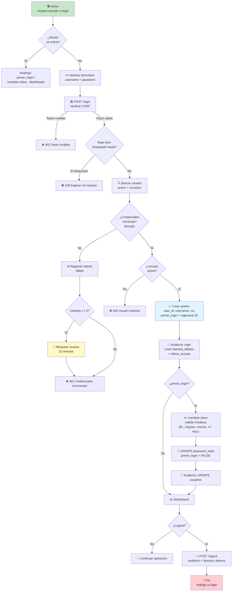

---

## P-02: Proceso de Recuperación de Contraseña

`PasswordResetController` — código de 6 dígitos por correo (vigencia 30 min), máx. 5 intentos/día, sesión temporal de 10 minutos para restablecer.

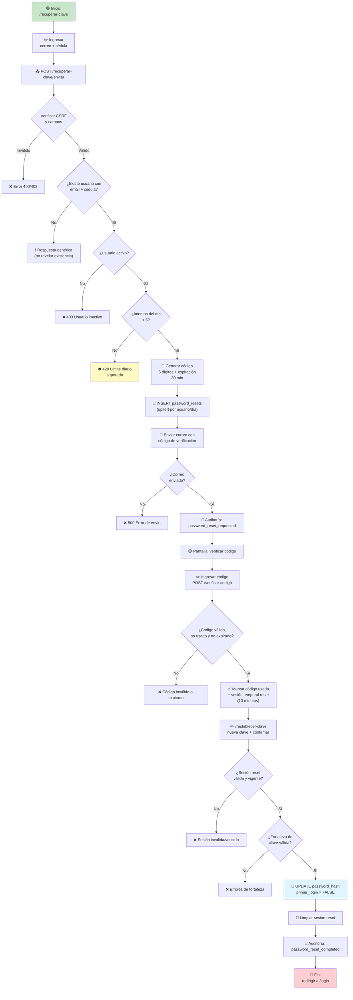

---

## P-03: Proceso de Registro de Bien Nacional

`BienController::store` — formulario multietapa (6 pasos), validación de duplicados, generación automática de códigos (interno Pub.9 + SUDEBIP), carga de imágenes, auditoría y movimiento de incorporación auto-aprobado. Roles: administrador, gerencia_bn, registrador.

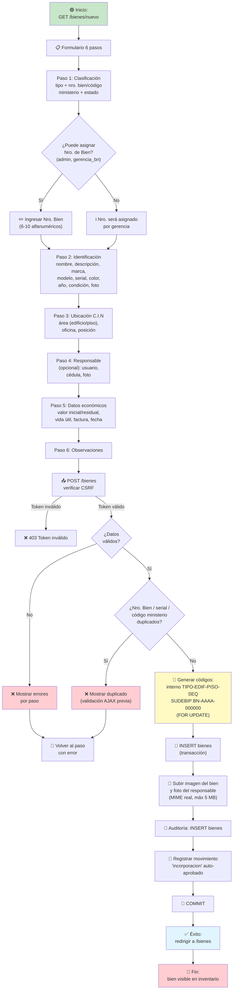

---

## P-04: Proceso de Edición de Bien

`BienController::update` — solo administrador, gerencia_bn (datos del registro) y controlador_inventario (corrige cualquier campo).

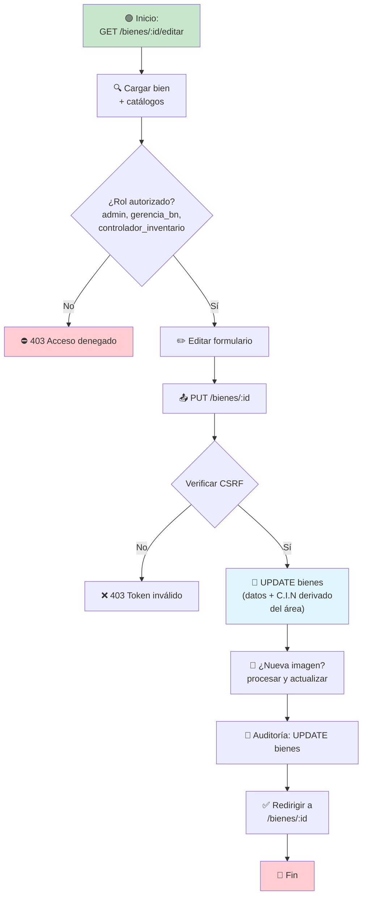

---

## P-05: Proceso de Desincorporación de Bien

`BienController::destroy` — solo administrador y gerencia_bn. Marca estado 5 (Desincorporado) y registra movimiento.

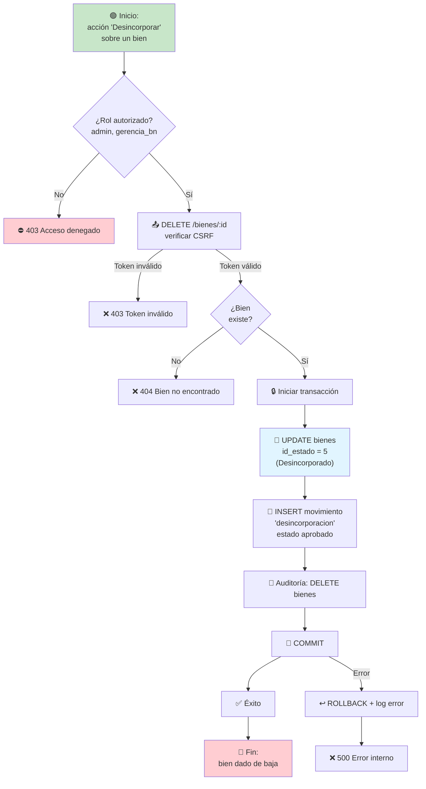

---

## P-06: Proceso de Verificación Semestral de Bien

`BienController::verificarSemestral` — roles: administrador, gerencia_bn, validador_inventario.

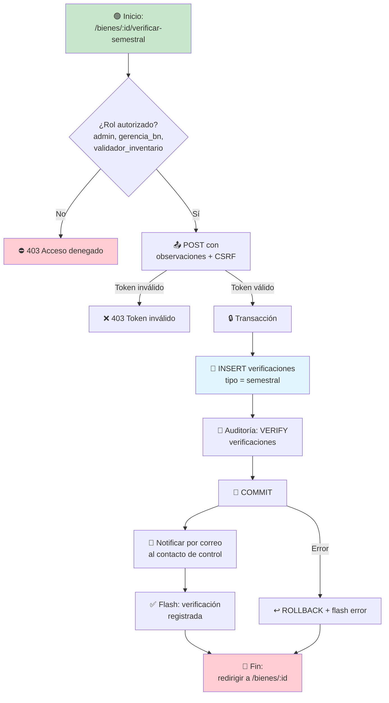

---

## P-07: Proceso de Movimiento / Acta de Bienes

`MovimientoController::store` — tipos: incorporación, traslado, desincorporación, asignación. Roles: administrador, gerencia_bn. Incluye previsualización del acta institucional y actualización del bien según tipo.

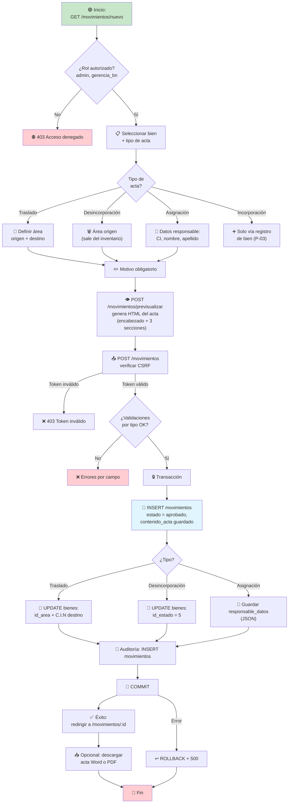

---

## P-08: Proceso de Aprobación / Rechazo de Movimiento

`MovimientoController::approve / reject` — solo se aplica a movimientos en estado `pendiente`; separación de funciones (no se aprueba acta propia).

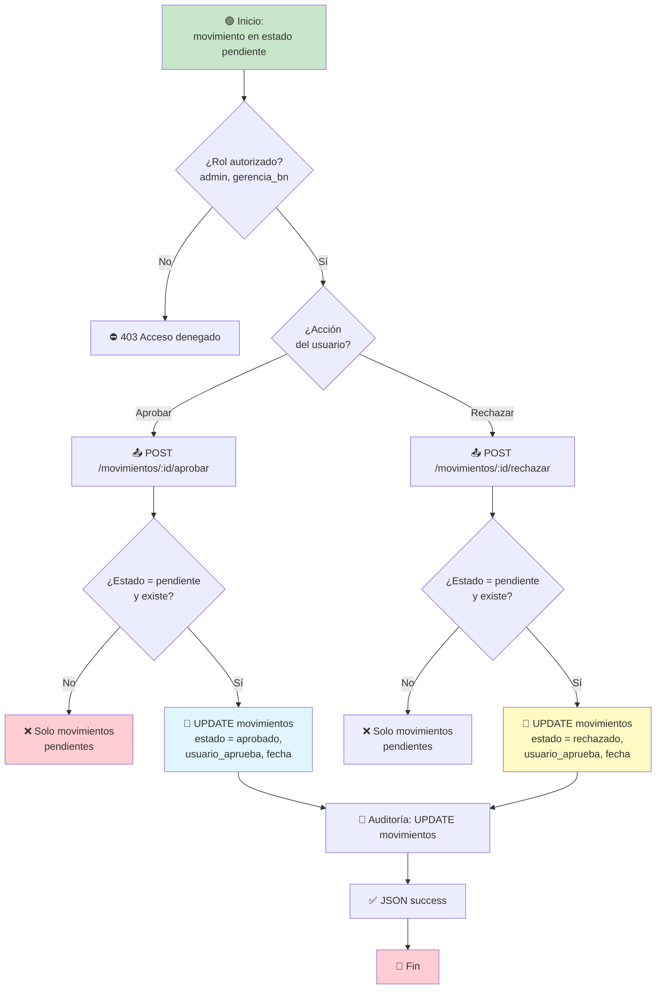

---

## P-09: Proceso de Generación de Reportes (BM-1 a BM-4)

`ReporteController` — roles: administrador, gerencia_bn, controlador_inventario. Formatos: HTML, PDF (TCPDF), CSV, Excel (PhpSpreadsheet).

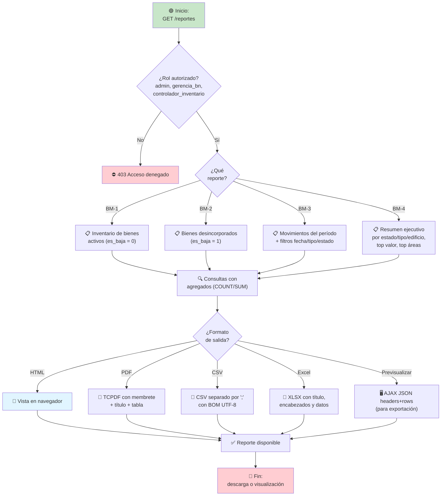

---

## P-10: Proceso de Control Mural (Inventario por Departamento)

`InventarioMuralController` — todos los roles autenticados. Muestra el inventario agrupado por edificio/área y permite exportar por departamento.

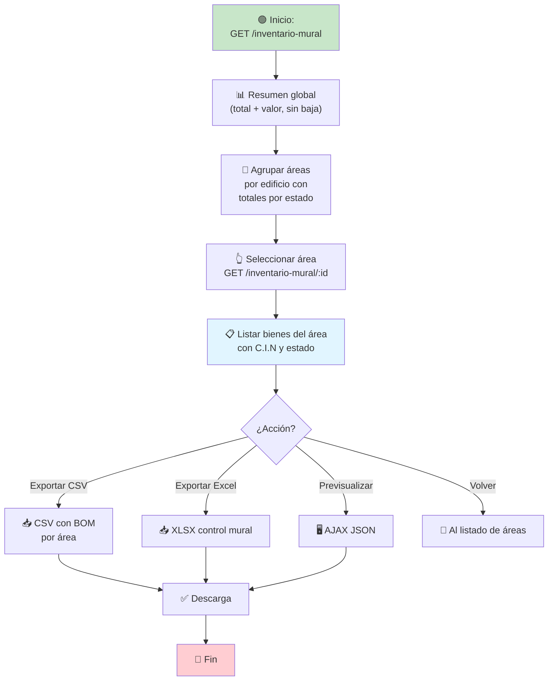

---

## P-11: Proceso de Gestión de Usuarios

`AdminController` — solo administrador. Username autogenerado (inicial del nombre + apellido, con desambiguación), clave temporal con cambio obligatorio en primer login.

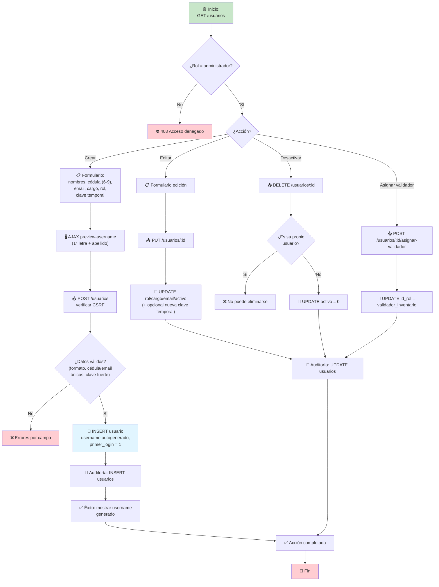

---

## P-12: Proceso de Gestión de Mantenimientos

`MantenimientoController` — ver: admin/gerencia_bn/controlador_inventario; crear/editar: admin/gerencia_bn.

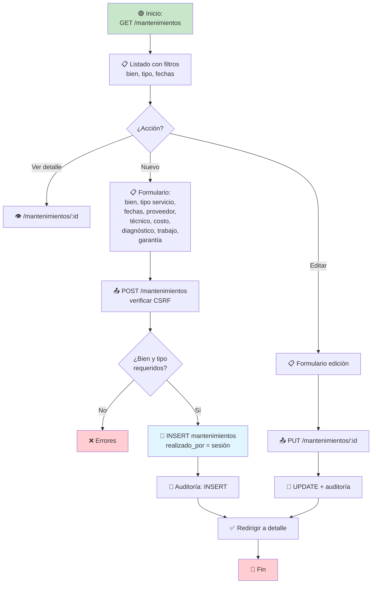

---

## P-13: Proceso de Auditoría del Sistema

`AuditoriaController` — roles: administrador, gerencia_bn, controlador_inventario. Registro automático de todas las operaciones (INSERT/UPDATE/DELETE/login/logout/VERIFY).

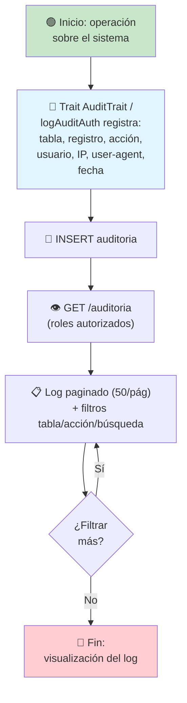

---

## P-14: Proceso de Notificaciones en Tiempo Real (SSE)

`NotificationController` — Server-Sent Events; el cliente mantiene conexión y recibe notificaciones nuevas cada 5 s (heartbeat cada 30 s).

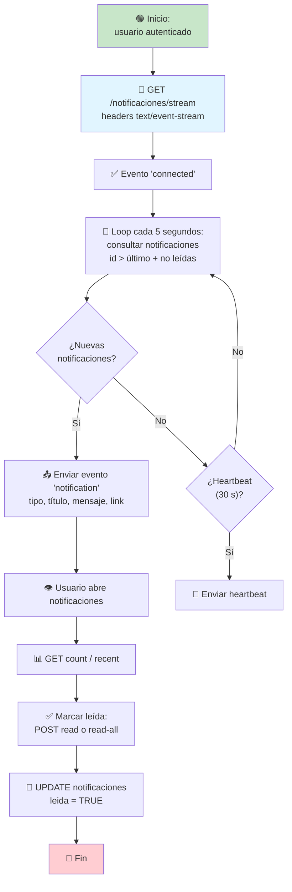

---

## P-15: Proceso de Backup de Base de Datos

`BackupHelper` — solo administrador.

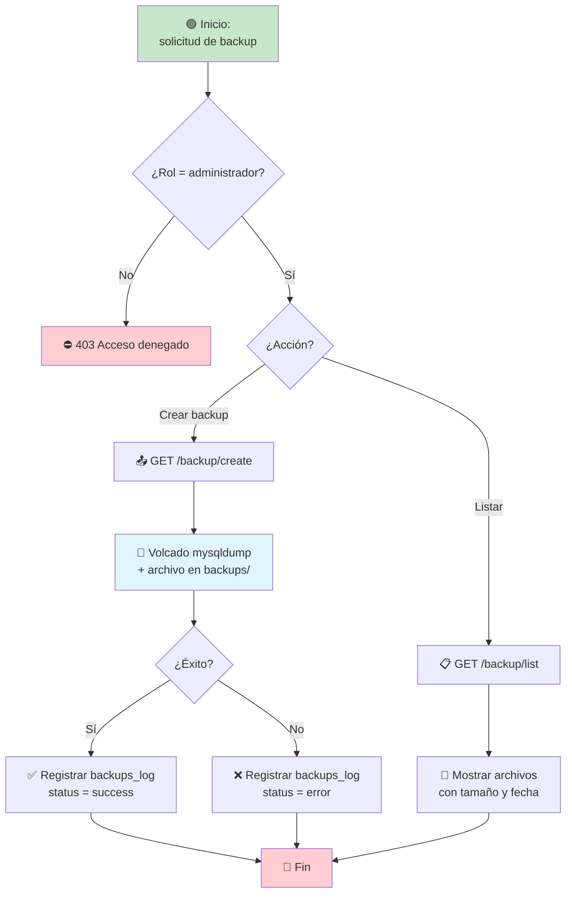

---

## P-16: Proceso de Configuración del Sistema

`ConfiguracionController` — solo administrador. Parámetros editables con validación de tipo de dato.

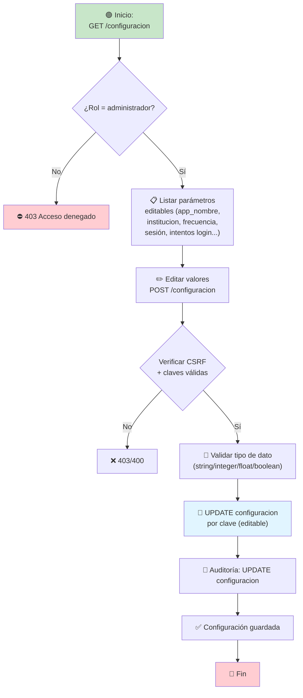

---

## Leyenda general de símbolos

- 🟢 **Inicio / Fin** — nodos verdes (inicio) y rojos (fin)
- 📋 **Proceso / pantalla**
- ✏️ **Entrada de usuario**
- ✅ **Éxito / confirmación**
- ❌ **Error / rechazo**
- ⛔ **Acceso denegado (403)**
- 💾 **Persistencia / escritura en BD**
- 🔍 **Consulta / lectura**
- 📝 **Auditoría**
- 📤 **Petición HTTP**
- 🔄 **Lógica / generación / bucle**
- ⏳ **Espera / pendiente**
- 📥 **Descarga**
- 📧 **Correo electrónico**
